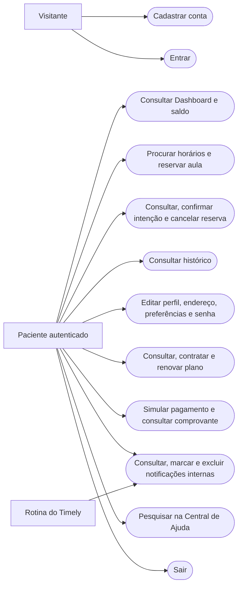
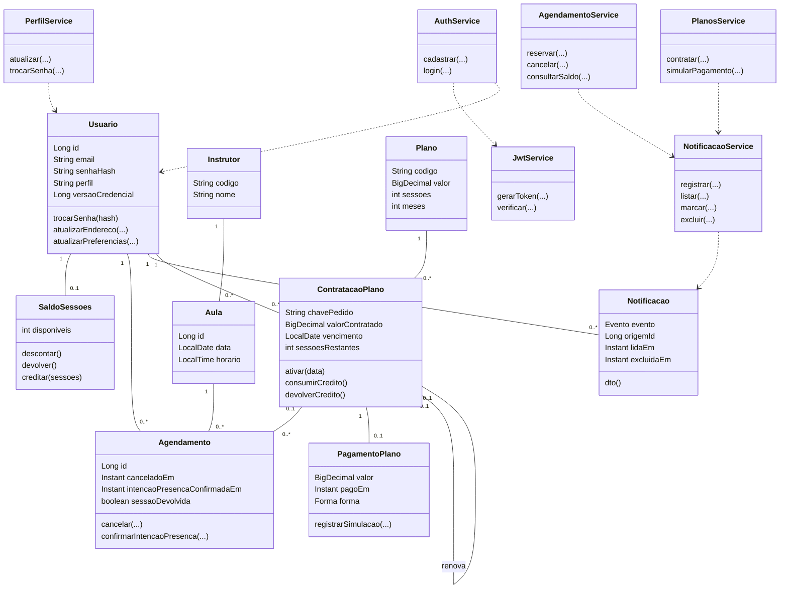
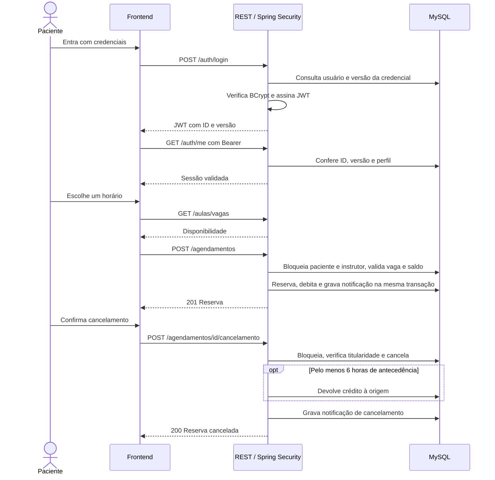
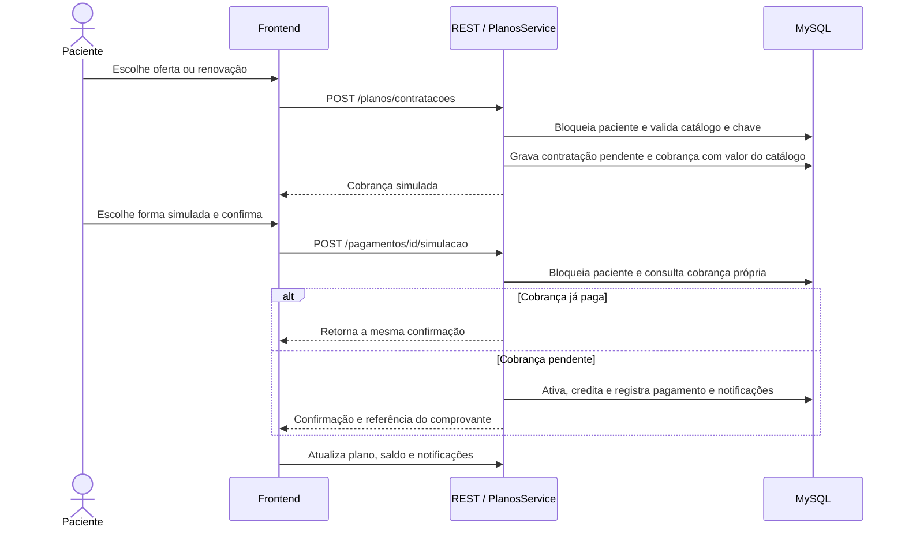
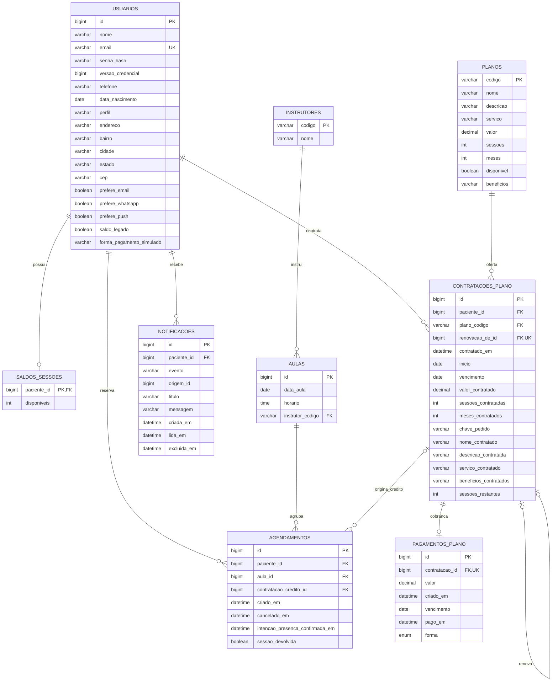

# Diagramas da área do paciente

Os quatro diagramas abaixo usam fonte Mermaid editável. As versões em PNG do
projeto ficam disponíveis como referência histórica: [casos de uso](../diagrama%20de%20caso%20de%20uso.png),
[classes](../Diagrama%20de%20Classes.png), [sequência](../Diagrama%20de%20sequ%C3%AAncia%20.png) e
[DER](../Diagrama%20Entidade%20e%20Relacionamento.png).

## Casos de uso

## Classes principais

## Sequências

## DER

Restrições compostas:

- Uma aula por `data_aula, horario, instrutor_codigo`.
- Uma contratação por `paciente_id, chave_pedido`.
- Uma notificação por `paciente_id, evento, origem_id`, inclusive após exclusão lógica.
- A referência da notificação é polimórfica. O evento indica a entidade de origem.
- A capacidade por aula, a reserva única por paciente/dia e a concessão de créditos
  são controladas pelas transações dos serviços. As versões atuais não usam
  índices únicos para essas três regras.
